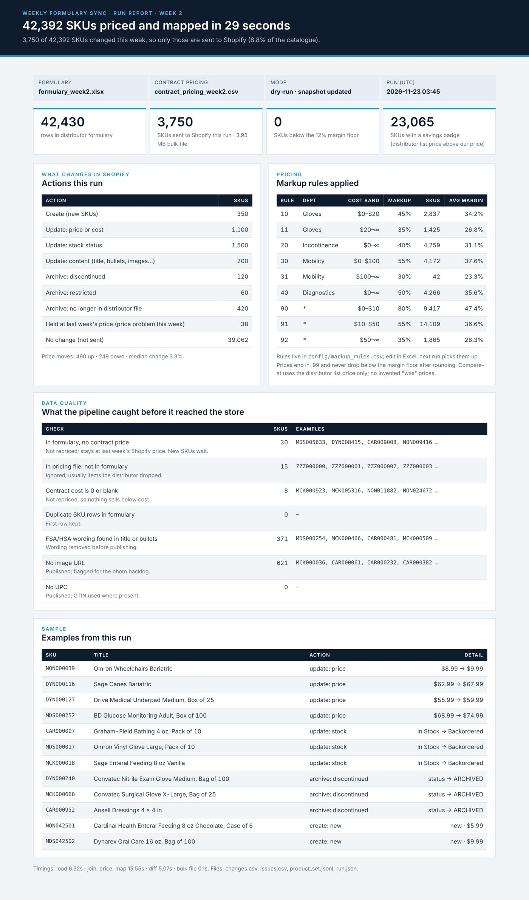

# Weekly formulary + contract pricing → Shopify sync

Merges the distributor's weekly Salsify formulary (42k+ rows) with the separate contract pricing file, prices every SKU with editable markup rules, maps it to Shopify fields and metafields, and sends **only what changed** to Shopify through the Admin GraphQL Bulk Operations API. Every run leaves a one-page report.



Full report: [docs/report_week2.html](docs/report_week2.html)

## Demo results (synthetic data, same shape as a med-surg distributor feed)

| Run | Formulary rows | Sent to Shopify | Run time* |
|---|---:|---:|---:|
| Week 1 – initial load | 42,500 | 42,500 creates | ~24 s |
| Week 2 – delta | 42,430 | 3,750 (2,800 updates · 600 archives · 350 creates) | ~29 s |
| Week 2 run again | 42,430 | 0 | ~26 s |

\*Local dry run on a 2-vCPU cloud container; build + diff + bulk file only, Shopify upload time not included.

Week 2 contained the churn the generator injected, and the pipeline found each group exactly: 1,100 price/cost changes, 1,500 stock-status changes, 200 title edits, 120 discontinued, 60 restricted, 420 SKUs gone from the file, 350 new SKUs, 38 SKUs with no or zero contract cost (held at last week's price, not archived), 15 pricing-only rows ignored, 371 SKUs with FSA/HSA wording cleaned. Compare-at (savings badge) comes only from the distributor's list price when it is above our price; the pipeline never invents a "was" price.

## How it works

```
inbox/ formulary.xlsx + pricing.csv
   │  1. load       read xlsx/csv as text (no silent number coercion of SKUs/UPCs)
   │  2. join       normalise SKU (trim, spaces, case) → left join on Item Number
   │  3. price      first matching rule in config/markup_rules.csv (dept × cost band)
   │                → .99 ending, never below the margin floor; compare-at = list price if higher, else rule %
   │  4. map        title, <ul> bullets, vendor, type, category path, UPC/GTIN, weight,
   │                images, metafields custom.uom / pack_qty / stock_status / category_path
   │  5. clean      drop FSA/HSA wording anywhere in title or bullets
   │  6. diff       hash price / stock / content / status vs last week's snapshot
   │  7. write      product_set.jsonl (changed SKUs only) + changes.csv + issues.csv + report.html
   ▼  8. push       stagedUploadsCreate → bulkOperationRunMutation(productSet) → poll → collect userErrors
Shopify            snapshot is replaced only when every bulk chunk completed
```

Rules the client controls without touching code: `config/markup_rules.csv` (open in Excel), `config/settings.json` (price ending, margin floor, archive vs draft, banned phrases, auto-ship departments), `config/field_map.json` (map to the real Salsify column headers).

## Decisions worth confirming

- **Handle is the upsert key.** It's created once from title + SKU and then kept forever, so a title edit updates the product instead of creating a duplicate.
- **Missing from this week's file → archived.** A SKU that is still in the formulary but has no/zero contract cost is *held* at last week's price instead.
- **Restricted = archived**, same as discontinued. Switch `archive_as` to `DRAFT` if preferred.
- **One SKU = one single-variant product.** Grouping sizes into variants is possible if the formulary carries a parent/family ID.
- **Stock** is written as a status metafield (In Stock / Backordered / Out of Stock). Quantities can be added if the distributor sends them.

## Run it

```bash
pip install -r requirements.txt
python sample_data/generate.py                      # two weeks of synthetic files
python sync.py --formulary sample_data/formulary_week1.xlsx --pricing sample_data/contract_pricing_week1.csv --out out_w1 --assume-applied
python sync.py --formulary sample_data/formulary_week2.xlsx --pricing sample_data/contract_pricing_week2.csv --out out_w2 --assume-applied
open out_w2/report.html
pytest -q                                           # 9 tests
```

Live push: set `SHOPIFY_STORE` and `SHOPIFY_ADMIN_TOKEN` (scopes: `write_products`, `write_inventory`) and add `--push`. In production it runs from `.github/workflows/weekly-sync.yml` every Monday; last week's snapshot is kept on the `sync-state` branch and each run's report is attached as a build artifact.

## Status

Built and tested end to end on synthetic data: join, pricing, mapping, diff, bulk file. The Shopify push (`formulary_sync/shopify_bulk.py`) follows the documented Bulk Operations flow but has **not yet been run against a live store**; first step of the engagement is a test run on a development store, including checking the `productSet` identifier argument and archive-only payloads against the store's API version.
